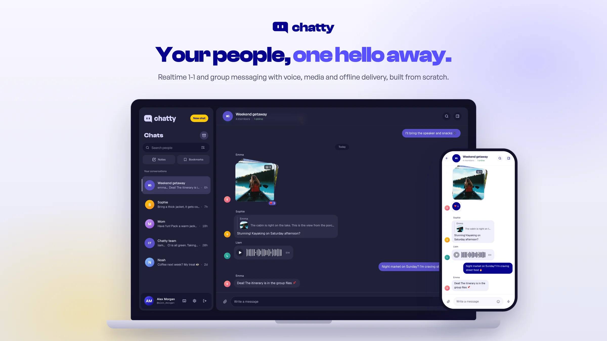

<p align="center">
  
</p>

<p align="center">
  <a href="https://github.com/ntm204/chatty/actions/workflows/verify.yml"></a>
  <a href="https://github.com/ntm204/chatty/releases/latest"></a>
  <a href="LICENSE"></a>
</p>

# Chatty

A realtime messaging app (1-1 and group chat, Zalo/Telegram-style) built from scratch to learn how a
production-grade chat system is put together: delivery that survives bad networks, permissions
checked on every path, and a deployment that runs on two instances behind a gateway.

**Current release: [`v0.2.1`](CHANGELOG.md)**, a local/private release. Public launch still needs
the external conditions in [Deployment](docs/DEPLOYMENT.md).

## Features

- **Messaging**: direct and group chats delivered over WebSocket, replies, mentions, reactions,
  edit history, retraction, pins, saved messages and bookmarks.
- **Media**: images (resized in the browser, thumbnails in the thread), files with safe downloads,
  voice messages with seeking and playback speed, stickers.
- **Reliability**: a durable offline outbox that resends exactly once, retryable uploads, a
  session that survives network drops, and an offline app shell.
- **Groups**: admin/member roles, invite policy, shared nicknames and message color, a media, file
  and link vault per conversation.
- **Privacy and accounts**: block and restrict, read-receipt and last-seen controls, email change,
  password reset by mail, account deletion.
- **Interface**: light and dark themes, phone layouts, keyboard navigation, reduced motion.

## Stack

| Part | Technology |
| --- | --- |
| Server | Node.js, Express, TypeScript, Prisma (PostgreSQL), Socket.IO, Zod |
| Web | React 18, Vite, TypeScript, Tailwind CSS v4, react-router |
| Shared | `packages/shared-types`, so server and web agree on API and event shapes at compile time |
| Deployment | Docker, two API instances behind Caddy, Redis adapter, optional Cloudflare Tunnel |

## Getting started

Requires **Node 22 or newer** and Docker. On Node 20 the web test suite fails to start with an
unrelated-looking error from undici.

```bash
npm ci
cp .env.example apps/server/.env      # first setup only; never overwrite an existing file
docker compose up -d postgres mailpit
npx prisma generate --schema apps/server/prisma/schema.prisma
npm run db:migrate --workspace apps/server
npm run db:seed --workspace apps/server   # optional: wipes the local database first
```

Then run the app in two terminals at the repository root:

```bash
npm run dev:server   # API + WebSocket on http://localhost:4000
npm run dev:web      # open http://localhost:5173
```

The seed creates `minh@test.com`, `an@test.com` and `binh@test.com` (password `SuperSecret123`),
one direct conversation and one group. It refuses to run against anything that is not localhost.
Mail goes to Mailpit at http://localhost:8025, so a reset link arrives as an email you can open.

| Mode | Web | API | Purpose |
| --- | --- | --- | --- |
| `dev:web` + `dev:server` | `http://localhost:5173` | `http://localhost:4000` | Daily development |
| Docker production stack | `http://localhost:8080` | `http://localhost:4000` | The built production topology; see [Deployment](docs/DEPLOYMENT.md) |
| `npm run test:e2e` | `http://localhost:5273` | `http://localhost:4100` | Browser tests against a separate database |

Good to know:

- Vite refuses to start if port 5173 is taken. Stop the previous dev process instead of changing ports.
- The development API and the Docker production gateway both bind port 4000, so run one at a time.
- Redis is optional in development; set `REDIS_URL` only to exercise the multi-instance path.
- `MAIL_TRANSPORT` has no default and the server will not boot without it.
- `npm run seed:demo` adds a large realistic dataset (hundreds of messages and every attachment
  kind) through the real API without wiping anything.
- Install, generate and migrate are setup steps, not commands to repeat every session.

## Checks

```bash
npm run verify          # changed tests + cached static checks (5-minute budget)
npm run verify:full     # every server and web test; release gate (10 minutes)
npm run test:e2e:smoke  # 7 core browser scenarios (3 minutes)
npm run test:e2e -- e2e/sending.spec.ts   # one affected flow
npm run test:e2e        # the full Chromium suite (15 minutes)
```

Browser tests need `npm run e2e:install` once. They start their own servers on `:4100`/`:5273`
against `chatty_e2e`, and a lock refuses overlapping runs. `--config playwright.webkit.config.ts`
covers Safari's engine; `npm run test:e2e:built` checks the production build's CSP, offline shell
and media. Every command has a time budget, stops at the first failure and cleans up its processes.

CI runs the complete suite on every push; a version tag also runs the browser suite before publishing
images. Which checks a change needs is decided in [AGENTS.md](AGENTS.md#run-and-check), and the
reasoning is in [ADR 0019](docs/adr/0019-two-speed-verification.md).

On Windows, a separate RAM-backed test database avoids slow bind mounts:

```powershell
docker compose -f docker-compose.test.yml up -d --wait
$env:CHATTY_TEST_POSTGRES_PORT = "5433"
npm run verify:full
```

## Project layout

```
apps/
  server/          API + WebSocket (layered: routes -> controller -> service)
  web/             React app (feature-based: features/<name>/...)
packages/
  shared-types/    Types that cross the wire between server and web
e2e/               Playwright specs: a real browser against a real server
docs/              Architecture, conventions, ADRs, plans and deployment
scripts/           Verification supervisor, convention audit, backup/restore, smoke test
```

Deployment lives in `apps/*/Dockerfile`, `docker-compose.prod.yml` and the optional
`docker-compose.tunnel.yml`.

## Documentation

| Document | What it answers |
| --- | --- |
| [ARCHITECTURE](docs/ARCHITECTURE.md) | How the pieces fit together and why |
| [ROADMAP](docs/ROADMAP.md) | What is built, in which order, and the history behind it |
| [PRODUCT-DIRECTION](docs/PRODUCT-DIRECTION.md) | Product values, the free-first constraint and how features are chosen |
| [DEPLOYMENT](docs/DEPLOYMENT.md) | The $0/month topology and what launch still needs |
| [Conventions](docs/conventions/) | Frontend, backend, git and release rules |
| [ADRs](docs/adr/) | Why each major technical decision was made |
| [CHANGELOG](CHANGELOG.md) | What changed in each release |
| [CLAUDE.md](CLAUDE.md) / [AGENTS.md](AGENTS.md) | Code rules and how AI agents work in this repository |

## Status

The experience-polish ledger records **49 of 60 items accepted locally** (11 partial, 0 planned).
Every partial item is complete in code and automated tests; what remains is acceptance on physical
devices (phone keyboards, touch, native notifications, screen readers). Current results live in
[one acceptance report](docs/plans/acceptance-2026-09-25.md);
`node scripts/check-experience-progress.mjs --json` lists the remaining items and fails if this
summary disagrees with the [ledger](docs/plans/experience-polish.md).

Known gaps:

- **No public deployment yet.** The topology is implemented; launch needs a domain, free
  Cloudflare and mail-provider accounts, and a backup destination.
- **Blocking is not a group-wide ban.** People who block each other still see a group they already
  share. See [ADR 0018](docs/adr/0018-group-admins-and-invite-policy.md).
- **Mail delivery is at-least-once**, and bounces are invisible until a production provider is set up.
- **Attachment URLs are bearer links** for their one-hour life. See
  [ADR 0007](docs/adr/0007-signed-attachment-urls.md).
- **Signing out on one device** stops its realtime connection only when its access token expires,
  at most 15 minutes, the same as its HTTP requests.
- **The message list is not virtualised.** History grows only through explicit paging, but the
  ceiling is real.

## Contributing

Issues and pull requests are welcome; see [CONTRIBUTING.md](CONTRIBUTING.md). The most valuable
report is a place where the docs and the code say different things.

## License

[MIT](LICENSE). `scripts/audit-rules.sh` is adapted from evondev's Dev Rules, also MIT.

The header image shows a demo conversation staged on a local test database; its photos are from
Unsplash by [Roberto Nickson](https://unsplash.com/photos/7BjmDICVloE),
[Christian Joudrey](https://unsplash.com/photos/mWRR1xj95hg) and
[Andrew Coelho](https://unsplash.com/photos/VB-w_3dnyvI).
